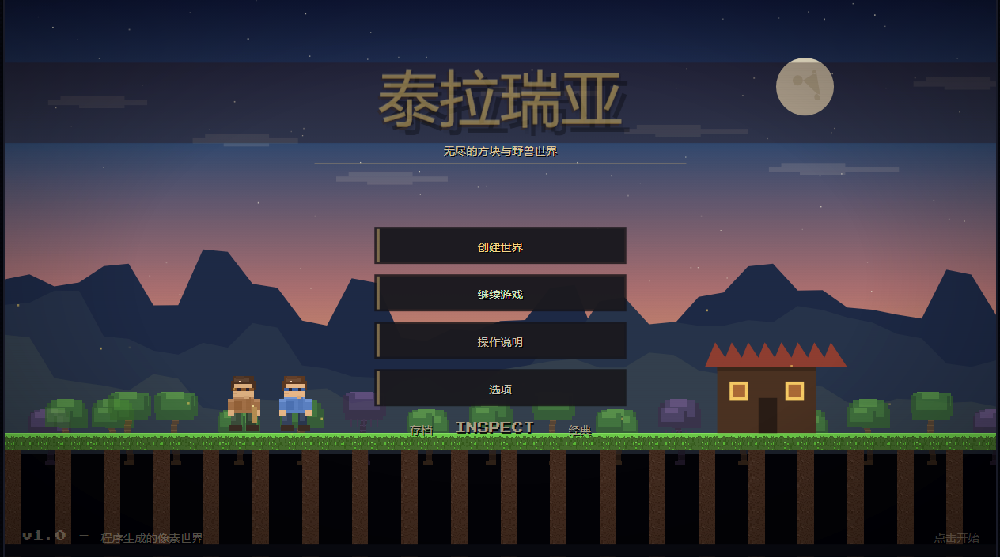
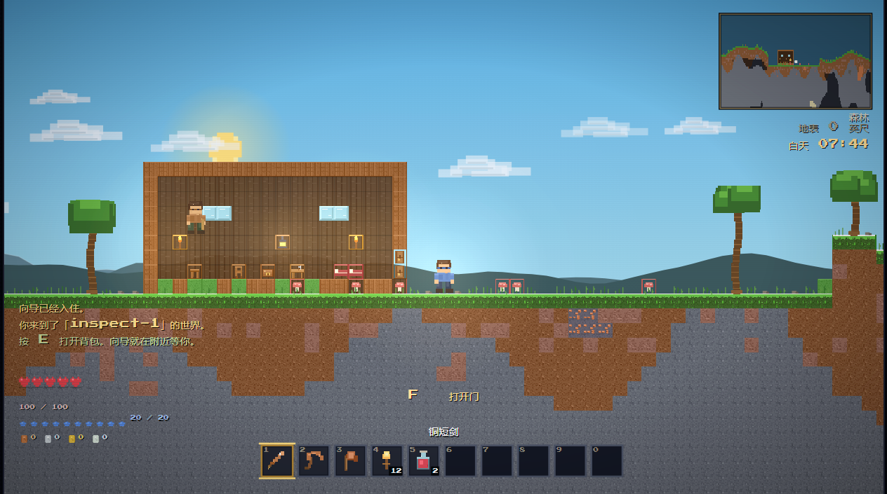
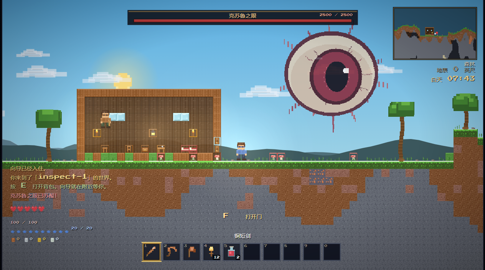
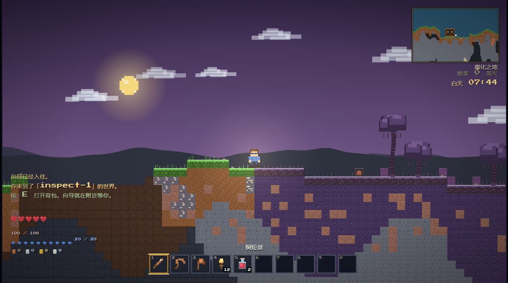
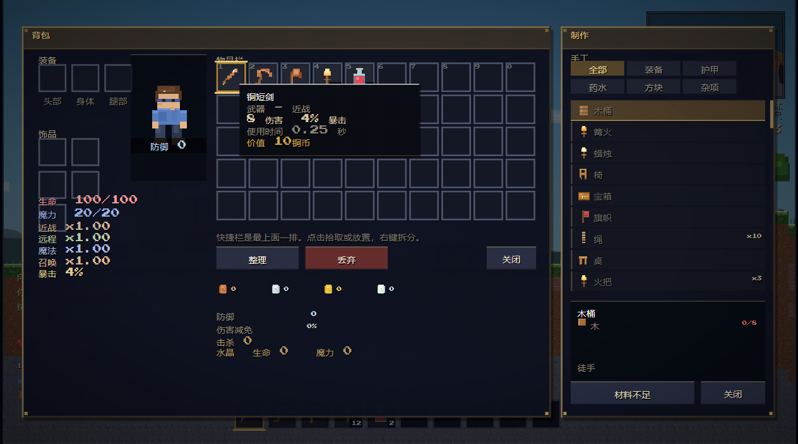

# 泰拉瑞亚 — 无尽深渊的世界

一个纯浏览器运行的 2D 沙盒动作冒险游戏，使用 Canvas 2D 绘制，程序化生成整个世界与全部像素素材，无任何外部图片依赖。界面、物品、对话、任务与聊天均为中文。

## 运行

最简单：直接双击 `index.html`。

如果浏览器对本地字体或存档有限制，可在本目录启动一个本地服务器：

```powershell
python -m http.server 8123 --bind 127.0.0.1
```

然后打开 <http://127.0.0.1:8123/index.html>。Windows 也可直接双击 `start-game.bat`。

## 操作

| 操作 | 按键 |
| --- | --- |
| 移动 | A / D，或 ← / → |
| 跳跃 / 游泳 | Space、W 或 ↑ |
| 下落 | S / ↓ |
| 穿过平台 | S + Space |
| 冲刺 | Shift |
| 钩爪 | H（需装备钩爪饰品） |
| 使用 / 挖掘 / 攻击 | 鼠标左键（可按住） |
| 放置 / 交互 | 鼠标右键或 F |
| 背包 | E |
| 快捷栏 | 1–0，或鼠标滚轮 |
| 快速喝药 | R |
| 地图 | M |
| 丢弃 | Q |
| 暂停 | Esc |

在背包中可用鼠标拖动物品、Shift+点击在背包与箱子间移动整堆，右键只移动一个。“整理”自动归并背包，“丢弃”删除光标上的物品。装备槽位接受对应部位的护甲和饰品。

## 内容

- 程序化 2D 世界：森林、雪原、沙漠、丛林、海洋、腐化 / 猩红、地下洞穴、矿道、地牢与地狱。
- 昼夜、天气（雨 / 雪 / 雷暴）、动态光照、视差背景、生态专属植被与地表装饰。
- 移动、跳跃、二段跳、冲刺、游泳、绳索、单向平台与钩爪。
- 挖掘、放置方块 / 墙体 / 平台 / 家具，三格门，箱子、床、火把、工作台、熔炉、铁砧、地狱熔炉、炼药台、织布机等设施。
- 50 格背包、10 格快捷栏、3 格护甲、5 格饰品、堆叠、整理、丢弃、出售。
- 完整的合成树：矿石 → 锭 → 工具 / 武器 / 护甲 / 饰品 / 药水，包含困难模式装备。
- 近战、弓箭 / 枪械、魔法、召唤四条战斗路线；弹药、法力、暴击、击退、减伤、生命 / 魔力上限成长。
- 普通、地下、生态专属、夜晚、血月与哥布林入侵敌人，包含 AI 追踪、跳跃、飞行、远程、受击、死亡与掉落。
- 7 个 Boss：史莱姆王、克苏鲁之眼、世界吞噬者、克苏鲁之脑、骷髅王、蜂后、血肉墙；含血量阶段、技能、仆从、专属掉落与困难模式转换。
- 6 位 NPC：向导、商人、护士、爆破专家、军火商、树妖；房屋检测、入住条件、对话、商店、治疗与向导任务。
- 生态掉落、宝箱、罐子、生命水晶、暗影珠 / 猩红之心、陨石、事件、奖杯与长期成长。
- 死亡、重生、床铺重生点与经典 / 专家 / 大师难度、软核 / 中核 / 硬核死亡规则。
- 小地图、已探索世界地图、Boss 血条、增益 / 减益、任务追踪、图鉴式提示。
- 像素字体 UI、按窗口分辨率渲染的高清文字（高分屏下依然锐利）、程序化音效与分层合成配乐（首次点击后启用音频）、粒子、光照、屏幕震动与打击反馈。
- 全中文界面：标题、创建世界、HUD、背包 / 合成、商店、对话、任务、地图、设置、死亡界面与聊天提示均已本地化；世界名和种子保留玩家输入的原文。
- 鼠标指针始终可见：菜单中为普通箭头，游玩中为十字准星，方便定位点击与瞄准。
- 角色与世界自动存档到浏览器 localStorage；标题界面可继续游戏。删除存档：在浏览器开发者工具中清除本站 localStorage。

## 文件结构

```
index.html          页面与脚本加载顺序
style.css           画布边框、像素缩放、扫描线
src/util.js         数学 / 噪声 / RNG / 文本 / 调色
src/lang.js         中文词典、物品名 / 描述、动态文本翻译
src/data.js         方块、物品、配方、敌人、Boss、NPC、战利品
src/sprites.js      程序化像素画：地块、图标、角色、敌人、Boss、树
src/audio.js        WebAudio 音效与程序化音乐
src/world.js        世界生成、生态、矿脉、洞穴、地牢、液体、存档序列化
src/entities.js     玩家、敌人、Boss、弹幕、掉落物、小怪、NPC
src/ui.js          标题、创建世界、HUD、背包、合成、箱子、商店、地图、暂停
src/game.js         主循环、输入、光照渲染、战斗、挖掘、建造、事件与存档
```

推荐使用较新的 Chrome / Edge / Firefox。游戏逻辑坐标固定为 960×540，画布会按窗口尺寸和设备像素比高清渲染，文字与 UI 不再被低分辨率拉伸；像素素材仍使用最近邻缩放以保持风格。

## 部署到 GitHub Pages

这是一个**纯静态、无后端**的游戏，不需要 Node.js 或服务器进程；GitHub Pages 可以直接托管。项目内的脚本、字体和图片都使用相对路径，所以部署在 `用户名.github.io/仓库名/` 子路径下也能正常运行。

1. 在 GitHub 新建一个仓库（建议 **Public**；私有仓库使用 Pages 可能需要付费套餐）。
2. 在本目录初始化并推送：

   ```powershell
   git init
   git add .
   git commit -m "Deploy Terraria clone"
   git branch -M main
   git remote add origin https://github.com/<你的用户名>/<仓库名>.git
   git push -u origin main
   ```

   `.gitignore` 已排除 `node_modules/`、`package*.json`、`ds_video/`、测试脚本和临时截图，不需要上传这些内容。

3. 打开仓库的 **Settings → Pages**，在 **Build and deployment** 中选择：
   - Source: **Deploy from a branch**
   - Branch: **main**
   - Folder: **/(root)**
4. 等待几十秒，访问：

   `https://<你的用户名>.github.io/<仓库名>/`

5. 首次打开后如果页面仍是旧缓存，按 **Ctrl + F5** 强制刷新。GitHub Pages 使用 HTTPS，Canvas、WebAudio、字体和 `localStorage` 都可以正常工作。

注意：

- 这是**单机游戏**，不需要也没有联机服务器；存档只保存在当前浏览器的 `localStorage` 中，不会跨设备同步。
- 从 `127.0.0.1` 换到 GitHub Pages 后，旧存档不会自动迁移（不同域名是不同存储空间）。目前没有导入/导出存档功能。
- `.nojekyll` 已放在根目录，避免 GitHub Pages 的 Jekyll 处理静态文件。
- 不要直接上传 `node_modules/` 或 `ds_video/`；它们不是游戏运行所需，且体积很大。

## 截图







